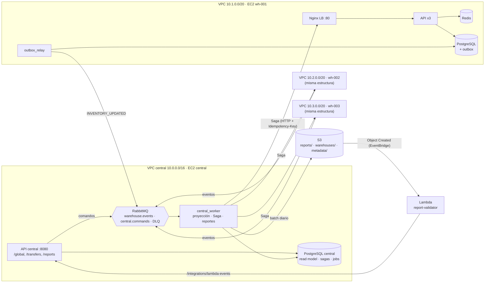

# Warehouse Cloud Platform

Plataforma distribuida multi-bodega del Proyecto Integrador de *Computación en la Nube e IoT*, implementada con sus **12 Fases** completas (el enunciado y las guías por fase están en [`project/`](project/README.md)).

## Arquitectura en AWS



- Hub-and-spoke: cada bodega tiene su VPC con peering **solo** hacia la central; las bodegas no se ven entre sí.
- Cada bodega es autónoma (API, PostgreSQL, Redis). La central consolida mediante eventos y no es la base operacional de nadie.
- Decisiones y trade-offs: [`docs/adr.md`](docs/adr.md) · Eventos, colas y DLQ: [`docs/eventos.md`](docs/eventos.md) · Pruebas y resultados: [`docs/pruebas.md`](docs/pruebas.md) · Saga: [`docs/saga.md`](docs/saga.md) · Inventario AWS: [`docs/aws.md`](docs/aws.md) · Extensión IoT: [`docs/iot.md`](docs/iot.md) · Colección API: [`docs/requests.http`](docs/requests.http) | [`docs/warehouse_api.postman_collection.json`](docs/warehouse_api.postman_collection.json)

## Estado por fase

| Fase | Implementación |
|---|---|
| 1. API + PostgreSQL | CRUD de productos, movimientos con bloqueo de fila, `CHECK quantity >= 0`, `db/schema.sql`, `db/seed.sql` montado e inicializado dinámicamente y migraciones |
| 2. Redis | Cache Aside con TTL de 30 s, invalidación síncrona, fallback a PostgreSQL y cabecera `X-Cache` |
| 3. RabbitMQ + workers | Transactional Outbox + relay; `POST /reports` → 202 + job asíncrono |
| 4. Múltiples bodegas | 3 EC2/VPC independientes; `docker-compose.warehouse.yml` parametrizado |
| 5. Load balancing | Nginx + 3 réplicas stateless por bodega (round-robin, failover por reintento y re-resolución DNS, `/health` en cada réplica) |
| 6. Saga | `POST /transfers` orquestado con compensación e idempotencia por paso, máquina de estados en [`docs/saga.md`](docs/saga.md) |
| 7. CQRS | Read model en la central, `/global/inventory/{sku}` con detección de bodegas desactualizadas |
| 8. S3 + Batch | Reporte diario y snapshots en S3 (cron 23:00 UTC o `POST /reports`), reejecutable |
| 9. Lambda | Validador de reportes disparado por S3 vía EventBridge |
| 10. Resiliencia | Reintentos con backoff, DLQ, replay, idempotencia persistente, matriz de errores |
| 11. Observabilidad + carga | `X-Correlation-ID` de punta a punta, logs JSON, `/metrics`, escenarios k6 |
| 12. Extensión IoT | Pipeline completo: Ingestion Service, topic exchange RabbitMQ (`warehouse.iot`), persistencia en BD, alertas por umbrales y simulador con 100 sensores en 5 bodegas ([`docs/iot.md`](docs/iot.md)) |

## Estructura

```text
main.tf, variables.tf, outputs.tf   Terraform: VPCs, peering, SGs, EC2, S3 (CloudFormation), Lambda
modules/{vpc,ec2}                   módulos reutilizados con for_each
scripts/install_docker.sh.tftpl     user data: swap + Docker
scripts/deploy.sh                   sincroniza app/ en las EC2 y levanta los contenedores
scripts/simulate_iot.py             simulador de sensores IoT (Fase 12)
app/docker-compose.central.yml      RabbitMQ, PostgreSQL central, API central, worker
app/docker-compose.warehouse.yml    una bodega: Nginx, API xN, outbox relay, PostgreSQL, Redis
app/src/backend/app                 API de bodega (FastAPI) + tests
app/src/backend/app/db              esquema (schema.sql), datos iniciales (seed.sql) y migraciones
app/src/central                     API central, worker (proyección, Saga, reportes), batch + tests
app/src/shared                      observabilidad y topología de RabbitMQ compartidas
app/src/lb                          Nginx (LB + frontend de la bodega)
lambda/report_validator             Lambda + tests
tests/load                          escenarios k6 y resultados
docs/                               ADRs (10 decisiones), eventos, pruebas
```

## Despliegue en AWS Academy

Requisitos: Terraform ≥ 1.7, AWS CLI, `rsync`, `python3` y (opcional) `k6`.

1. **Credenciales.** *Start Lab* → *AWS Details* → *AWS CLI: Show*. Pega el bloque en `~/.aws/credentials` bajo **`[lab1]`**; es el perfil que usa `main.tf`. Las credenciales caducan con cada sesión.
2. **Llave SSH.** *AWS Details* → *Download PEM*. Guárdala como `labsuser.pem` en la raíz del repo y ejecuta `chmod 400 labsuser.pem`.
3. **Infraestructura.**
   ```bash
   terraform init
   terraform apply
   ```
4. **Aplicación.** El primer despliegue espera a que termine el user data:
   ```bash
   scripts/deploy.sh            # central primero y luego las 3 bodegas
   scripts/deploy.sh wh-002     # solo una máquina
   API_REPLICAS=1 CACHE_ENABLED=false scripts/deploy.sh wh-001   # configuraciones para experimentos
   ```
   Al terminar imprime las URLs. Los secretos (RabbitMQ y PostgreSQL) se generan en `.deploy.env`, que está fuera de git.
5. **Apagar.** `terraform destroy`.

Si el lab se reinicia, las EC2 cambian de IP pública: ejecuta `terraform apply` (actualiza la URL de la Lambda) y `scripts/deploy.sh`.

## Endpoints principales

| Servicio | URL | Endpoints |
|---|---|---|
| Bodega (vía LB) | `http://<ip-bodega>/api` | `/docs`, `/products` (CRUD, `/by-sku/{sku}`), `/inventory/{id}`, `/inventory/movements` (`Idempotency-Key`), `/inventory/{id}/movements`, `/inventory/outbox/audit`, `/health`, `/metrics` |
| Frontend de bodega | `http://<ip-bodega>/` | UI de productos y movimientos |
| Central | `http://<ip-central>:8080` | `/` (dashboard), `/docs`, `/global/inventory[/{sku}[/live]]`, `/warehouses/status`, `/transfers`, `/reports`, `/reports/jobs/{id}`, `/metrics`, `/admin/queues`, `/admin/dlq/{cola}/replay`, `/admin/inject/{tipo}` |
| RabbitMQ | `http://<ip-central>:15672` | usuario `warehouse`, contraseña en `.deploy.env` |

## Desarrollo local

```bash
cd app && ./warehouse.sh up      # central :8080, RabbitMQ :15672, bodegas :8001-8003
```

Pruebas unitarias y de integración (SQLite, sin Docker):

```bash
pip install -r app/src/backend/app/requirements-dev.txt boto3
(cd app/src/backend/app && pytest -q)
(cd app/src/central && pytest -q)
(cd lambda/report_validator && pytest -q)
```
