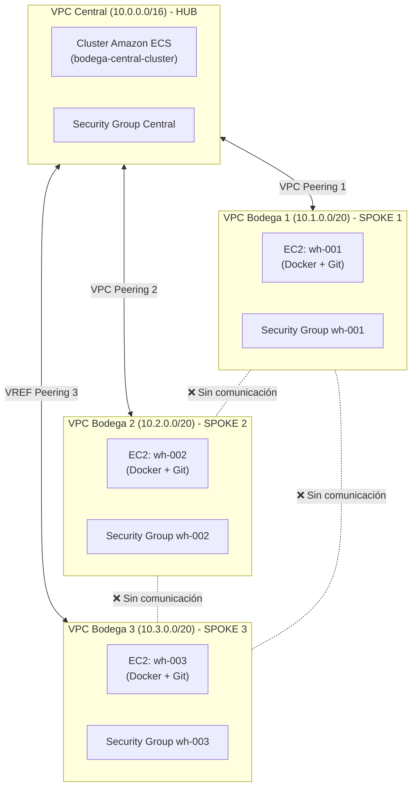

# 🏢 Warehouse Cloud Platform — Infraestructura IaC con Terraform

Repositorio de Infraestructura como Código (IaC) para la **Plataforma Distribuida Multi-Bodega (*Warehouse Cloud Platform*)**, desplegada en **Amazon Web Services (AWS)** mediante **Terraform**.

---

## 📐 1. Arquitectura de Red (Hub-and-Spoke)

La solución implementa una topología centralizada **Hub-and-Spoke** con aislamiento estricto entre bodegas:



### Tabla de Direccionamiento y Dimensionamiento (Right-Sizing)

| Nodo | Componente | CIDR VPC | Subred Pública | Subred Privada | Propósito / Justificación |
| :--- | :--- | :--- | :--- | :--- | :--- |
| **Central** | `vpc-central` + ECS | `10.0.0.0/16` | `10.0.1.0/24` | `10.0.2.0/24` | **Hub:** Concentrador de servicios analíticos, clúster ECS y APIs consolidadas. |
| **Bodega 1** | `vpc-wh-001` + EC2 | `10.1.0.0/20` | `10.1.1.0/24` | `10.1.2.0/24` | **Spoke:** Nodo operacional autónomo con Docker y base de datos local. |
| **Bodega 2** | `vpc-wh-002` + EC2 | `10.2.0.0/20` | `10.2.1.0/24` | `10.2.2.0/24` | **Spoke:** Nodo operacional autónomo. |
| **Bodega 3** | `vpc-wh-003` + EC2 | `10.3.0.0/20` | `10.3.1.0/24` | `10.3.2.0/24` | **Spoke:** Nodo operacional autónomo. |

> **Criterio de Diseño:** 
> - **Right-Sizing (`/20`):** Cada bodega cuenta con 4,096 direcciones IP, evitando el sobre-dimensionamiento (*over-provisioning*) y siguiendo buenas prácticas de conservación de espacio RFC 1918.
> - **Mnemotecnia:** El 2.° octeto identifica de inmediato el nodo (`10.0` Central, `10.1` WH-001, `10.2` WH-002, `10.3` WH-003), garantizando cero colisiones.
> - **Aislamiento Total:** Las bodegas **no** tienen peering entre sí; la caída de una bodega no afecta la operación de las demás.

---

## 🛠️ 2. Requerimientos Previos

1. **Terraform CLI** versión `1.7.0` o superior instalada.
2. **Cuenta activa de AWS Academy** (Learner Lab).
3. **Llave SSH `vockey.pem`** descargada de AWS Academy.
4. **AWS CLI** instalado y configurado con credenciales de la sesión actual:
   ```ini
   # ~/.aws/credentials
   [lab1]
   aws_access_key_id = ASIA...
   aws_secret_access_key = ...
   aws_session_token = ...
   ```

---

## 📂 3. Estructura del Repositorio

```text
actividad/
├── main.tf                     # Orquestación de infraestructura modular con for_each
├── variables.tf                # Definición de variables y mapa de bodegas
├── outputs.tf                  # Salidas dinámicas (IPs, comandos SSH, VPC IDs)
├── terraform.tfvars            # Parámetros del entorno y URL del repo a clonar
├── scripts/
│   └── install_docker.sh.tftpl # Script de User Data (Ajustes avanzados EC2)
├── modules/
│   ├── vpc/                    # Módulo reutilizable de VPC + Subnets + Route Tables
│   ├── ec2/                    # Módulo reutilizable de instancia EC2 + User Data
│   └── ecs/                    # Módulo para el cluster Amazon ECS
├── .gitignore                  # Exclusión estricta de binarios, keys y archivos de estado
└── README.md                   # Esta documentación
```

---

## 🚀 4. Guía de Uso Paso a Paso

### Paso 1: Configurar Variables
Edita el archivo `terraform.tfvars` con los valores de tu entorno:

```hcl
aws_region = "us-east-1"
key_name   = "vockey"
repo_url   = "https://github.com/SebastianReyesLeyton/cloud-computing.git"
```

### Paso 2: Inicializar Terraform
Descarga los proveedores y registra los módulos:

```bash
terraform init
```

### Paso 3: Planificar el Despliegue
Genera y valida la simulación de recursos a crear:

```bash
terraform plan -var-file=terraform.tfvars
```

### Paso 4: Desplegar la Infraestructura en AWS
Aplica la configuración para crear los recursos:

```bash
terraform apply -var-file=terraform.tfvars
```
*(Escribe `yes` cuando lo solicite).*

Al finalizar, Terraform mostrará en consola:
- IDs e IPs públicas y privadas de cada bodega.
- Comandos SSH listos para copiar y pegar.
- Datos del clúster ECS Central.

---

## 🔑 5. Conexión y Verificación de las Bodegas

### Conexión por SSH
Dale permisos a tu llave privada `vockey.pem` y conéctate:

```bash
chmod 400 vockey.pem

# Ejemplo de conexión a una bodega (usando la IP pública mostrada en outputs)
ssh -i vockey.pem ec2-user@<IP_PUBLICA_BODEGA>
```

### Comprobar el Aprovisionamiento Automático (User Data)
Una vez dentro de la instancia EC2, el script habrá instalado Docker, Git y clonado el código:

```bash
# Verificar Docker
docker --version
docker ps

# Ver el registro del script de instalación (User Data)
cat /var/log/user-data.log

# Verificar el repositorio de la aplicación
ls -la /home/ec2-user/app
```

---

## 🧹 6. Destrucción de la Infraestructura

> [!WARNING]
> Al terminar la sesión de laboratorio o la práctica, destruye los recursos para **no consumir los créditos** de AWS Academy:

```bash
terraform destroy -var-file=terraform.tfvars
```
*(Escribe `yes` cuando lo solicite).*

---

## 🎓 7. Aspectos Técnicos Destacados para Evaluación

- **Uso de `for_each` con `map(object)`:** En [variables.tf](file:///home/dark/Documentos/cloud-computing/actividad/variables.tf), la infraestructura de las bodegas está parametrizada. Si se requiere una bodega adicional (`wh-004`), solo se añade una clave al mapa sin modificar el código en `main.tf`.
- **Ajustes Avanzados (User Data):** El script de inicialización [scripts/install_docker.sh.tftpl](file:///home/dark/Documentos/cloud-computing/actividad/scripts/install_docker.sh.tftpl) demuestra aprovisionamiento automatizado sin intervención manual vía SSH.
- **Seguridad por Diseño (Security Groups):** Cada bodega tiene su propio Security Group en su VPC. El tráfico interno está estrictamente restringido para aceptar peticiones solo desde la VPC Central (`10.0.0.0/16`).
