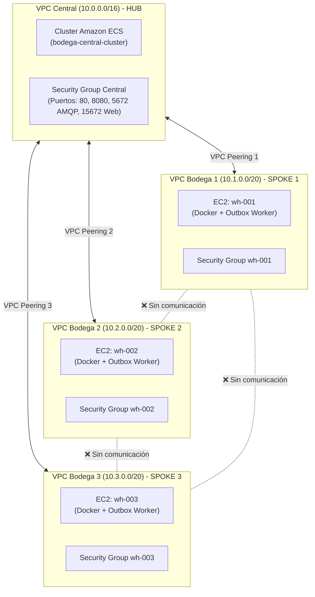

# 🏢 Warehouse Cloud Platform — Infraestructura IaC con Terraform

Repositorio oficial del equipo para el despliegue de la **Plataforma Distribuida Multi-Bodega (*Warehouse Cloud Platform*)**, desplegada en **Amazon Web Services (AWS)** mediante **Terraform**.

---

## 👥 Guía Rápida para Compañeros de Equipo (Despliegue idéntico en 3 pasos)

Si eres un integrante del equipo y quieres tener exactamente la misma infraestructura en tu propia cuenta de AWS Academy:

### 1. Clonar este repositorio
```bash
git clone https://github.com/benjamin94773/WareHouse.git
cd WareHouse
```

### 2. Configurar tus credenciales de AWS Academy
1. En tu AWS Academy Learner Lab, dale a **Start Lab** (espera el círculo verde).
2. Haz clic en **AWS Details** -> **Show** en la sección **AWS CLI**.
3. Copia ese texto y pégalo en tu archivo `~/.aws/credentials` con el encabezado `[lab1]`:
   ```ini
   [lab1]
   aws_access_key_id = ASIA...
   aws_secret_access_key = ...
   aws_session_token = ...
   ```
4. Descarga tu archivo de llave privada (`labsuser.pem`) de AWS Details, guárdalo dentro de la carpeta del proyecto y dale permisos:
   ```bash
   chmod 400 labsuser.pem
   ```

### 3. Desplegar en AWS
```bash
# 1. Inicializar plugins
terraform init

# 2. Desplegar toda la infraestructura
terraform apply -var-file=terraform.tfvars
```
*(Escribe `yes` cuando lo solicite y en 2 minutos tendrás toda la red, peerings y servidores arriba).*

---

## 📐 Arquitectura de Red (Hub-and-Spoke con Right-Sizing)



---

## 🔑 Conectarse por SSH a las Instancias EC2

El sistema utiliza la imagen Ubuntu Server. Para conectarte a cualquier bodega utiliza el usuario **`ubuntu`**:

```bash
# Conectar a Bodega 1
ssh -i labsuser.pem ubuntu@<IP_PUBLICA_WH001>

# Conectar a Bodega 2
ssh -i labsuser.pem ubuntu@<IP_PUBLICA_WH002>

# Conectar a Bodega 3
ssh -i labsuser.pem ubuntu@<IP_PUBLICA_WH003>
```

Una vez dentro:
```bash
# Verificar Docker instalado
docker --version
docker compose version

# Verificar el código del repositorio listo
ls -la /home/ubuntu/app
```

---

## 🛑 Destruir la Infraestructura (Limpiar el Lab de AWS)

Para no consumir los créditos de AWS Academy al terminar:

```bash
terraform destroy -var-file=terraform.tfvars
```
*(Escribe `yes` cuando lo solicite y Terraform eliminará automáticamente los 49 recursos).*
