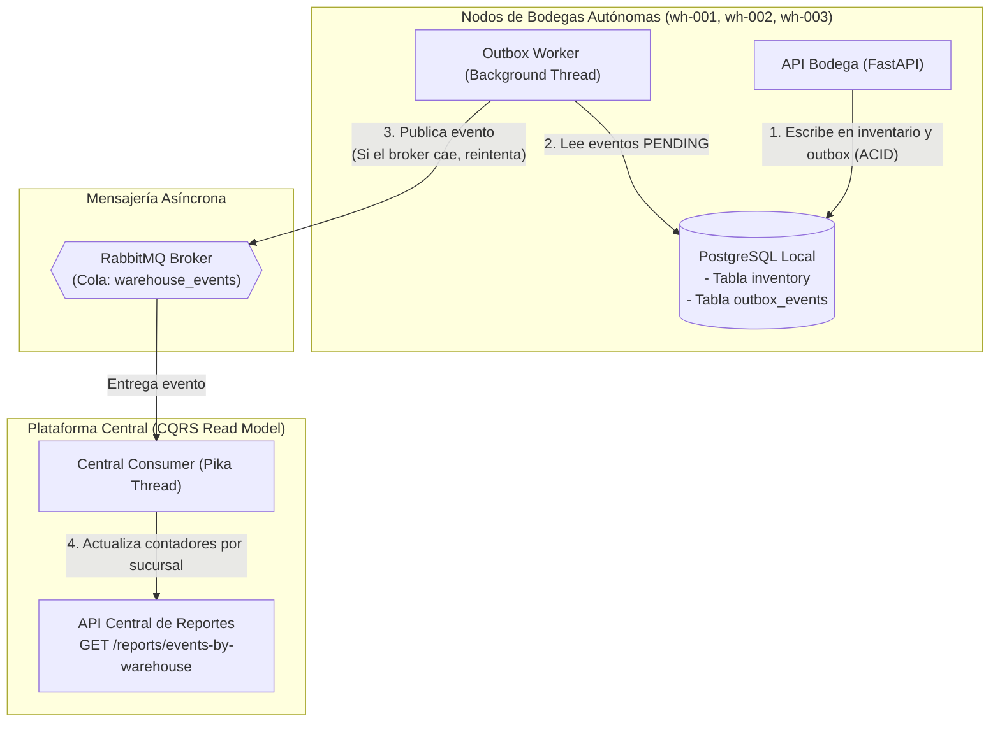

# 📦 Warehouse Cloud Platform — Aplicación Multi-Bodega, Outbox Pattern y Reportes

Aplicación distribuida en Python (**FastAPI**) con base de datos relacional (**PostgreSQL**), mensajería asíncrona (**RabbitMQ**), patrón **Transactional Outbox** y **Plataforma Central de Reportes**.

---

## 🏗️ 1. Arquitectura de la Solución



---

## 🌐 2. Mapa de Servicios y Puertos en Local

| Servicio | Contenedor | Puerto Local | Documentación / Acceso |
| :--- | :--- | :--- | :--- |
| **RabbitMQ Broker** | `warehouse_broker` | `5672` (AMQP) / `15672` (Web) | Panel: [http://localhost:15672](http://localhost:15672) (`guest`/`guest`) |
| **Plataforma Central & Reportes** | `warehouse_central_platform` | `8080` | Swagger: [http://localhost:8080/docs](http://localhost:8080/docs) |
| **Bodega 1 (WH-001)** | `api_wh001` / `db_wh001` | API: `8001` / DB: `5433` | Swagger: [http://localhost:8001/docs](http://localhost:8001/docs) |
| **Bodega 2 (WH-002)** | `api_wh002` / `db_wh002` | API: `8002` / DB: `5434` | Swagger: [http://localhost:8002/docs](http://localhost:8002/docs) |
| **Bodega 3 (WH-003)** | `api_wh003` / `db_wh003` | API: `8003` / DB: `5435` | Swagger: [http://localhost:8003/docs](http://localhost:8003/docs) |

---

## 🚀 3. Cómo Ejecutar Todo en Local

Desde la carpeta `actividad/app`:

```bash
cd ~/Documentos/cloud-computing/actividad/app

# Levantar todos los servicios en segundo plano
docker compose up -d --build
```

Para ver el estado de los contenedores:
```bash
docker compose ps
```

---

## 🧪 4. Guía de Prueba para Demostración al Profesor

### Paso A: Verificar el reporte inicial en la Central
Abre en tu navegador o terminal:
```bash
curl http://localhost:8080/reports/events-by-warehouse
```
Verás que todas las bodegas (`WH-001`, `WH-002`, `WH-003`) inician con `0` eventos.

---

### Paso B: Crear un producto y registrar movimiento en WH-001
1. **Crear producto en WH-001:**
```bash
curl -X POST "http://localhost:8001/products/" \
     -H "Content-Type: application/json" \
     -d '{"sku": "LAP-001", "name": "Laptop Dell", "description": "Inspiron 15", "category": "Computo", "unit": "UNIDAD"}'
```

2. **Registrar entrada de inventario (`RECEIPT`):**
```bash
curl -X POST "http://localhost:8001/inventory/movements" \
     -H "Content-Type: application/json" \
     -d '{"product_id": 1, "type": "RECEIPT", "quantity": 100, "reference": "Compra Proveedor #101"}'
```

3. **Verificar que el evento llegó a la Central:**
```bash
curl http://localhost:8080/reports/events-by-warehouse
```
*Respuesta:* `WH-001` ahora muestra `total_events: 1` con tipo `RECEIPT: 1`.

---

### Paso C: ¡La Prueba de Fuego! Simulación de caída del Broker (RabbitMQ)

1. **Apagar RabbitMQ:**
```bash
docker stop warehouse_broker
```

2. **Registrar 2 movimientos en WH-001 con RabbitMQ caído:**
```bash
# Venta 1
curl -X POST "http://localhost:8001/inventory/movements" \
     -H "Content-Type: application/json" \
     -d '{"product_id": 1, "type": "SHIPMENT", "quantity": 15, "reference": "Venta Cliente #201"}'

# Venta 2
curl -X POST "http://localhost:8001/inventory/movements" \
     -H "Content-Type: application/json" \
     -d '{"product_id": 1, "type": "SHIPMENT", "quantity": 5, "reference": "Venta Cliente #202"}'
```
> **Nota clave:** La API responde `201 Created` de inmediato. **La bodega NUNCA se bloqueó.**

3. **Verificar que los eventos están resguardados en el Outbox local:**
```bash
curl http://localhost:8001/inventory/outbox/audit
```
*Verás los 2 eventos con estado `"status": "PENDING"`, esperando que el broker reviva.*

4. **Encender RabbitMQ (Recuperación del servicio):**
```bash
docker start warehouse_broker
```

5. **Verificar la entrega automática y el reporte central:**
Espera 3 a 5 segundos y consulta el reporte en la Central:
```bash
curl http://localhost:8080/reports/events-by-warehouse
```
*Resultado:* La Central ahora muestra **`total_events: 3`** para `WH-001` (`RECEIPT: 1`, `SHIPMENT: 2`).  
¡Los datos que ocurrieron durante la caída llegaron intactos a la Central!

---

## 🛑 5. Detener los Servicios

```bash
docker compose down
```
*(Si quieres borrar también los datos de las bases de datos para empezar de cero, agrega el flag `-v`: `docker compose down -v`).*
