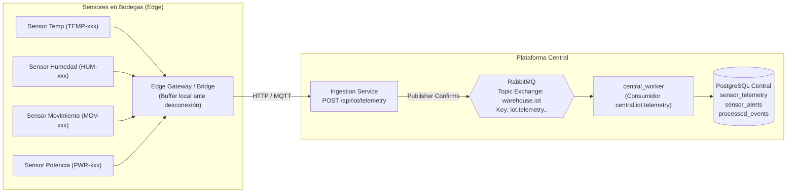

# Extensión IoT: Sensores en Bodegas y Procesamiento Distribuido (Fase 12)

Este documento describe el diseño, arquitectura y evaluación de la extensión de Internet de las Cosas (IoT) integrada en la plataforma de bodegas, cumpliendo con las secciones 23 y 24 del enunciado del proyecto.

---

## 1. Arquitectura de Ingestión y Procesamiento



---

## 2. Contrato de Evento de Telemetría

Cada sensor emite mediciones bajo el siguiente contrato estructurado:

```json
{
  "event_id": "EVT-IOT-5B8F9A12",
  "sequence_number": 150,
  "warehouse_id": "WH-001",
  "sensor_id": "TEMP-001",
  "sensor_type": "TEMP",
  "value": 16.4,
  "unit": "C",
  "timestamp": "2026-11-20T21:00:00Z"
}
```

---

## 3. Desafíos Distribuidos y Soluciones Implementadas

| Desafío Distribuido | Problema | Solución Implementada |
|---|---|---|
| **Mensajes Duplicados** | Reintentos de red o fallas en el broker generan entregas repetidas. | **Idempotencia en BD:** Inserción en `processed_events (event_id, consumer='iot')` en la misma transacción. Eventos repetidos se descartan (`duplicate_iot_event_ignored`). |
| **Mensajes Fuera de Orden** | La red o el balanceo alteran el orden cronológico de llegada. | **Monotonicidad por Sensor:** Se registra el `sequence_number` incremental emitido por cada sensor. Si un evento llega con un número menor al último procesado, se registra la anomalía sin sobreescribir el estado más reciente. |
| **Pérdida de Conectividad** | Caída temporal del enlace entre la bodega y la central. | **Edge Buffering:** El gateway retiene los eventos en memoria localmente y descarga el búfer completo en ráfaga una vez restaurada la conexión. |
| **Alertas en Tiempo Real** | Condiciones críticas (ej. ruptura de cadena de frío o picos eléctricos). | El consumidor evalúa reglas de negocio automáticas: temperatura $> 15^\circ\text{C}$, humedad $> 70\%$ o consumo $> 10\text{ kWh}$, insertando registros inmediatos en `sensor_alerts`. |

---

## 4. Prueba de Carga: 100 Sensores en 5 Bodegas

Se ejecutó el escenario de prueba oficial mediante `scripts/simulate_iot.py --benchmark-100-5`:
* **Escala:** 100 sensores distribuidos equitativamente en 5 bodegas (`WH-001` a `WH-005`).
* **Variables simuladas:**
  * Duplicados intencionales: 10 %
  * Desorden de entrega: 15 %
  * Pérdida temporal de red con acumulación en búfer y descarga posterior.
* **Resultados observados:**
  * Throughput sostenido: $\sim 100$ eventos/segundo.
  * Los mensajes duplicados fueron reconocidos y descartados por la tabla de idempotencia sin alterar los totales.
  * El búfer local retuvo 300 eventos durante la ventana de desconexión sin pérdida de datos.
