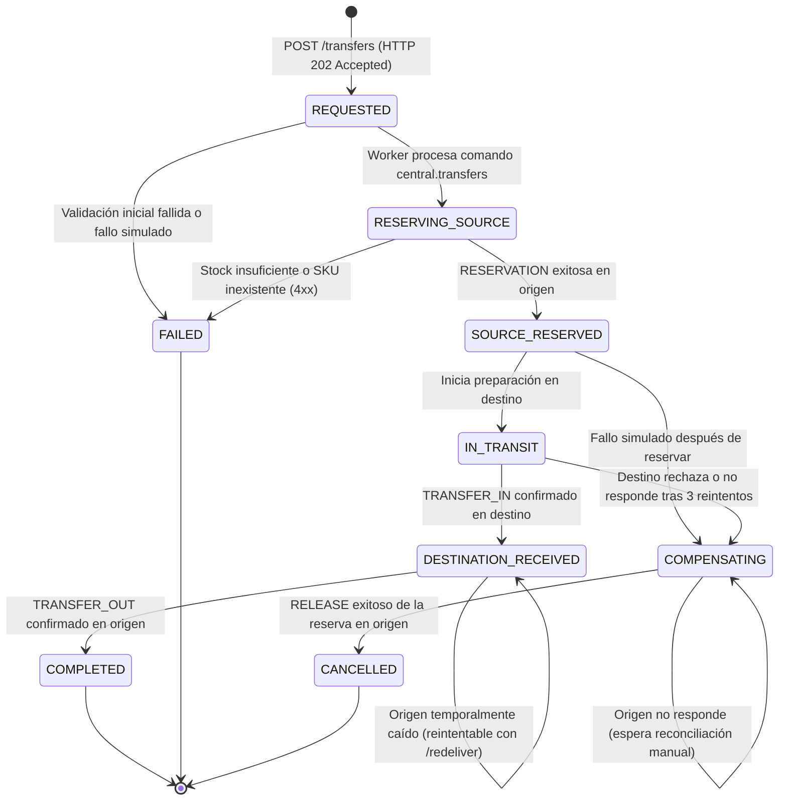

# Transferencias entre Bodegas y Patrón Saga (Fase 6)

Este documento detalla la orquestación, estados, idempotencia y compensaciones del flujo de transferencias entre bodegas autónomas.

---

## 1. Problema de consistencia distribuida

Una transferencia entre la bodega origen (ej. `WH-001`) y la bodega destino (ej. `WH-002`) modifica dos bases de datos PostgreSQL independientes conectadas a través de redes aisladas. No existe una transacción SQL única (`BEGIN ... COMMIT`) entre ambas.

---

## 2. Máquina de estados (Saga Orquestada)

La plataforma central actúa como orquestador centralizado, gestionando la ejecución paso a paso mediante comandos asíncronos en RabbitMQ y llamadas idempotentes con cabecera `Idempotency-Key`.

---

## 3. Matriz de compensaciones y garantías

| Estado de falla | Motivo común | Estado final | Compensación automática |
|---|---|---|---|
| `RESERVING_SOURCE` | Stock insuficiente o SKU desconocido en origen | `FAILED` | Ninguna (no se alteró el inventario). |
| `IN_TRANSIT` | Bodega destino caída, timeout tras 3 reintentos o rechazo | `CANCELLED` | `RELEASE`: se libera la reserva en la bodega origen devolviendo las unidades a disponible. |
| `DESTINATION_RECEIVED` | Origen no responde al confirmar `TRANSFER_OUT` | `DESTINATION_RECEIVED` (con error) | **No se compensa** porque las unidades ya están físicamente en destino. Se expone `POST /transfers/{id}/redeliver` para reintentar el paso final sin duplicar. |

---

## 4. Idempotencia en cada paso

Cada solicitud enviada por el orquestador a las bodegas incluye una clave única en la cabecera HTTP:
* Reserva: `Idempotency-Key: <transfer_id>:reserve`
* Recepción destino: `Idempotency-Key: <transfer_id>:in`
* Despacho origen: `Idempotency-Key: <transfer_id>:out`
* Liberación compensatoria: `Idempotency-Key: <transfer_id>:release`

La tabla `inventory_movements` cuenta con una restricción única (`ux_inventory_movements_idempotency_key`), garantizando que reintentos de red, reinicios de worker o comandos duplicados jamás dupliquen movimientos de stock.
